# ISPmanager UML 与架构

本文用 UML / 架构图描述系统边界、模块依赖、核心实体关系与关键业务状态机。表字段详见 [02-数据库表结构.md](./02-数据库表结构.md)。

## 1. 系统上下文

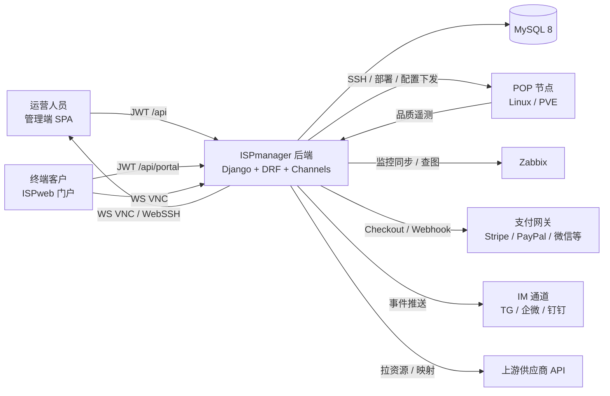

## 2. 部署架构

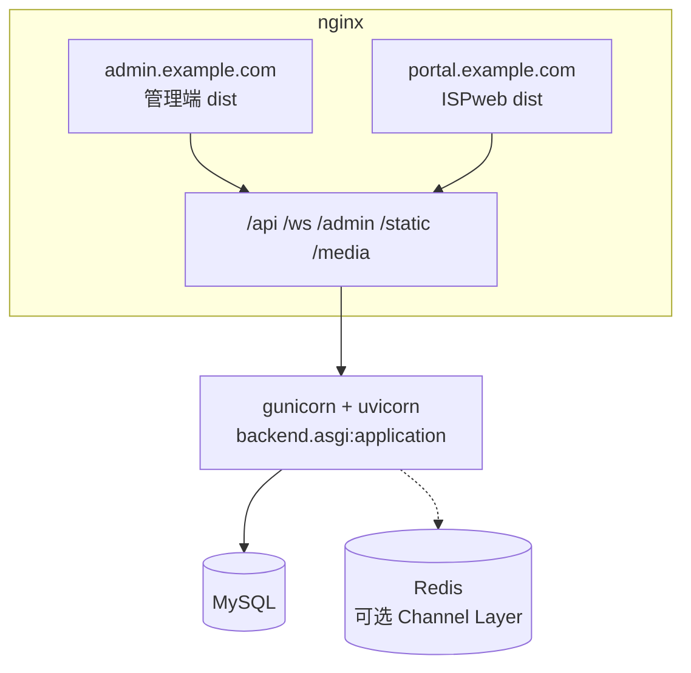

- HTTP 与 WebSocket 共用 ASGI。
- 前端 History 路由：`try_files ... /index.html`。
- 静态与媒体由 nginx 直出，不经 Django。
- 未设 `CHANNEL_REDIS_URL` 时通道层为进程内存；生产多 worker 建议 Redis。

## 3. 后端应用模块依赖

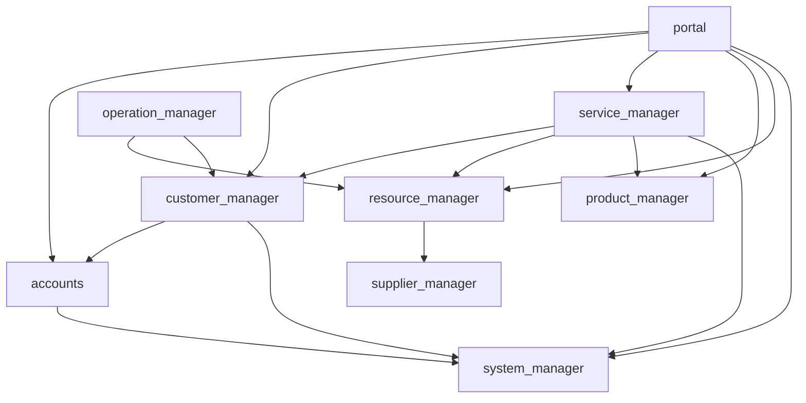

`log_manager` 已安装但无模型，审计实际落在各业务 `*OperationLog` / `IMMessageLog`。

## 4. 核心实体关系（概念 ER）

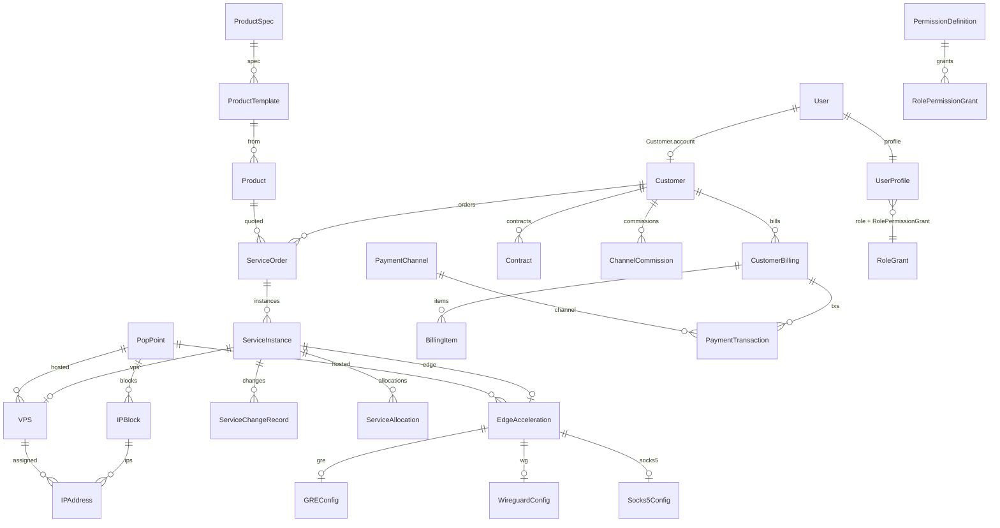

说明：角色不是独立表，`UserProfile.role` 为枚举字符串，授权行在 `accounts_rolepermissiongrant`。

## 5. 账号与客户绑定

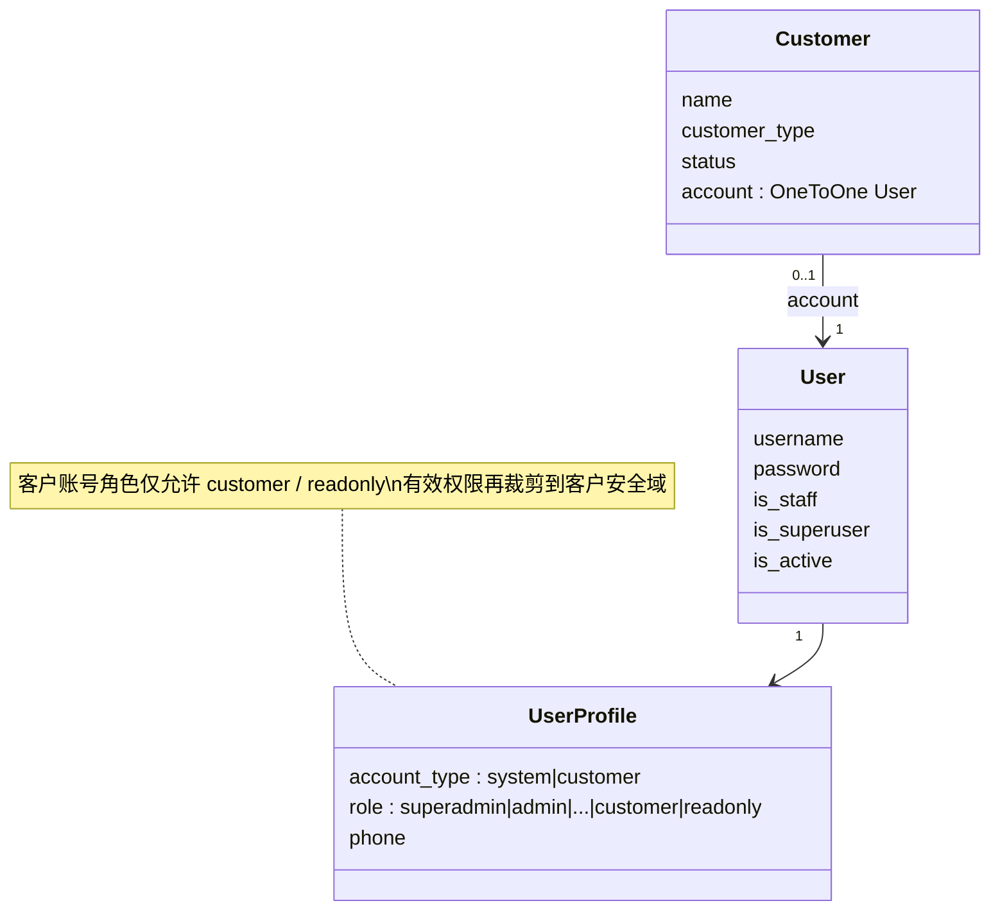

## 6. 服务工单状态机

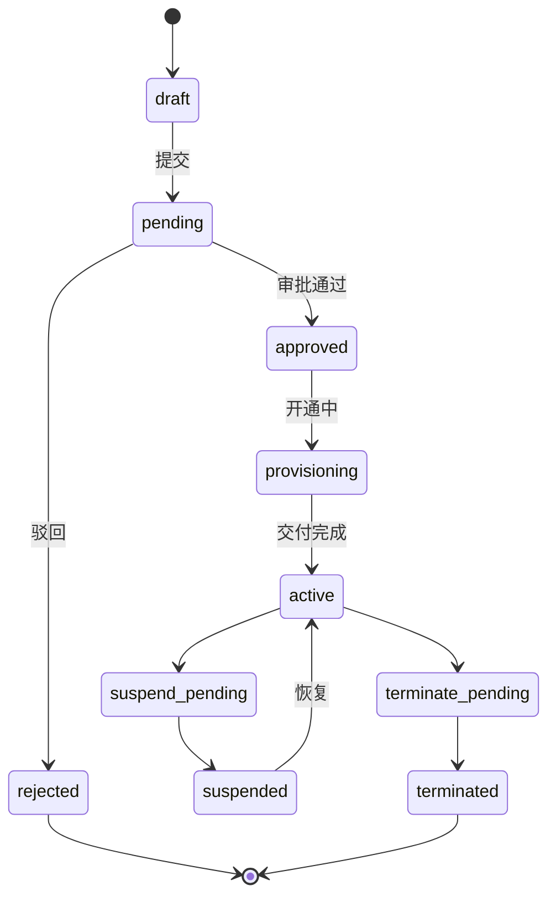

生命周期阶段（`current_stage`）并行记录：下单 → 需求确认 → 测试 → 正式使用 → 变更 → 终止。

## 7. 服务实例状态机

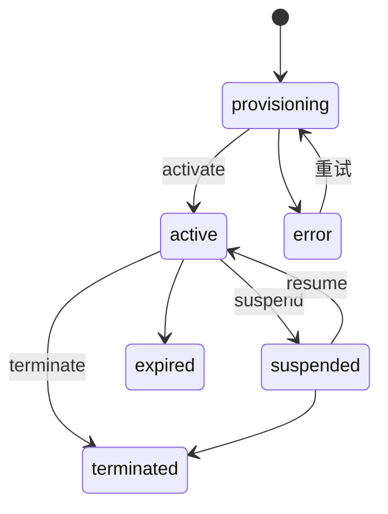

实例 `activate/suspend/terminate` 会同步 VPS / Edge / 带宽 / IP 的客户归属与状态。

## 8. 变更与计费时序

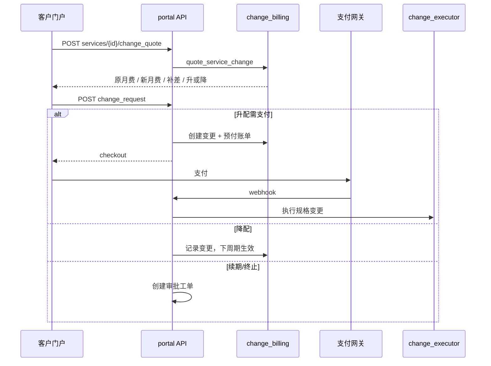

## 9. 权限模型

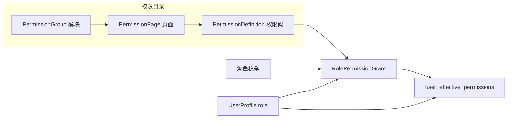

权限码层级（上级覆盖下级）：

1. 模块：`service.manage`
2. 页面：`service.change.manage`
3. 配置分类 / 配置项：`system.settings.billing.manage`

动作仅两种：`view`（只读）、`manage`（增删改执行）。

## 10. 管理端前端模块（路由）

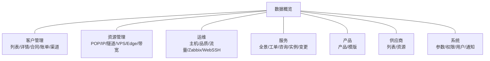

路由守卫读取 `meta.permission`，与 `accounts.role.view` 等页面码匹配。

## 11. 门户前端模块

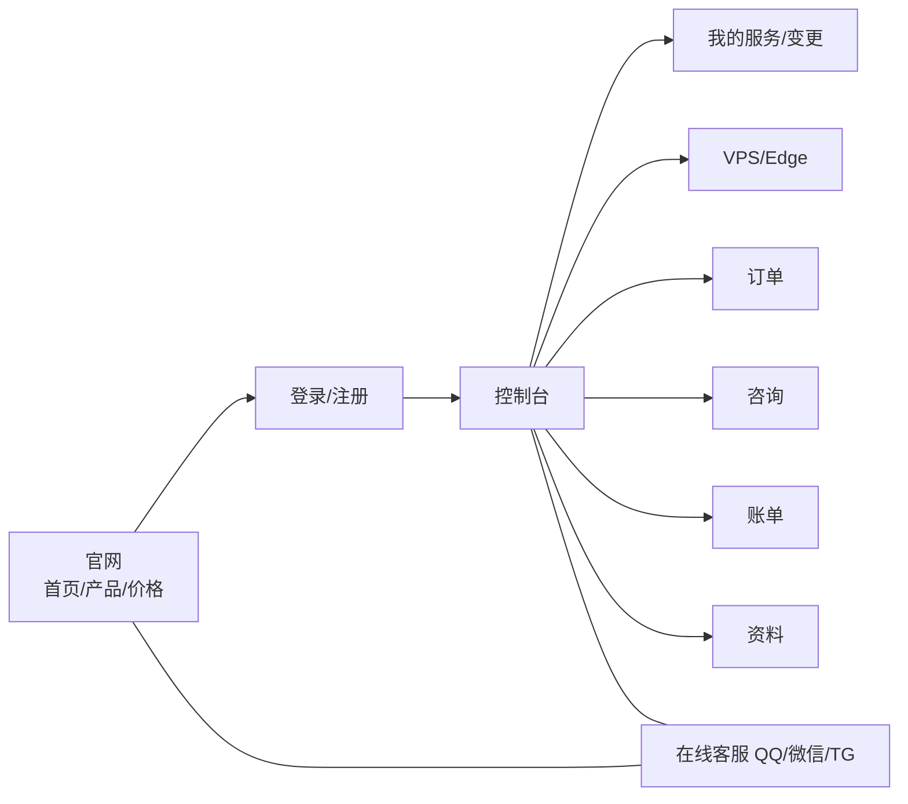

## 12. 实时通道

| WebSocket | 用途 | 鉴权 |
|-----------|------|------|
| `/ws/resource/vnc/{vps_id}/` | VPS noVNC | JWT 查询参数 |
| `/ws/resource/pop-ssh/{pop_id}/` | POP SSH | JWT |
| `/ws/operation/webssh/{type}/{id}/` | 运维 WebSSH | JWT；type=`pop\|vps\|monitoring_host\|custom` |

中间件：`resource_manager.ws_auth.JWTAuthMiddleware`。

## 13. 逻辑分层

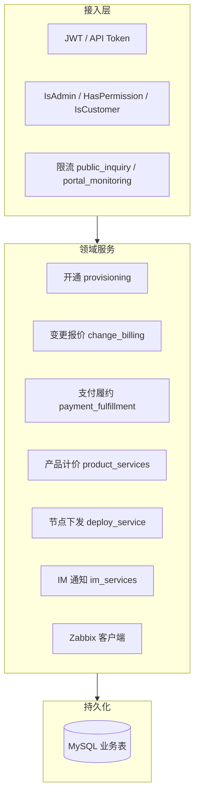
