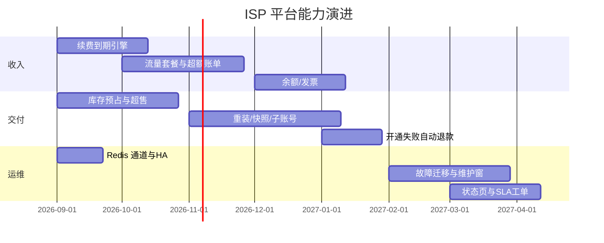

# 作为专业 ISP / VPS 服务商的后续扩展与逻辑优化

本文基于当前 ISPmanager + ISPweb 代码与数据模型，从**可售、可交付、可计费、可运维、可风控**五条能力线给出后续建设建议。优先级按「对收入与稳定性影响」排序，而不是按开发量。

---

## 1. 现状判断（相对专业 ISP 控制台）

平台已经具备一条可运转的主链路：

- 产品上架 → 门户注册/下单/支付 → 工单开通 → VPS / 边缘交付
- 升降配报价与补差价、降配下周期生效
- POP 下发、IP / 带宽、Zabbix 流量 95、WebSSH / VNC
- 渠道推广佣金、多币种汇率、IM 通知、角色权限

与成熟 ISP（SolusVM/Virtualizor + WHMCS/Blesta，或自研如 BuyVM / Bandwagon 一类）相比，缺口主要在：

1. **交付自动化覆盖不全**（大量历史资源无实例、Socks5 等需人工）
2. **计费仍偏「月租快照」**，缺流量包、超额、按量、账期冻结的完整产品化
3. **库存与超售**未形成严格容量账本
4. **客户成功与工单 SLA** 仍偏咨询表单，不是工单台
5. **多租户安全与审计**对门户操作尚未按权限码强制
6. **高可用与节点故障迁移**缺少产品级流程

---

## 2. 建议优先落地的功能扩展

### P0 — 直接影响售卖与续费

#### 2.1 完整续费与到期引擎

现状：门户「续期」走人工工单；资源有 `expire_time`，缺少统一催缴 / 宽限 / 停机 / 回收状态机。

建议：

- 为每个 `ServiceInstance` 定义：到期日、宽限期、停机日、回收日
- 定时任务：T-7 / T-3 / T-1 邮件+IM+站内信；到期暂停电源；宽限后释放 IP 并回收库存
- 门户一键续费：按当前规格 × 账期（月/季/年）直接出账支付，不必再开「续期工单」
- 与现有 `billing_cycle`、汇率、信誉额打通

#### 2.2 流量与带宽产品化

现状：运维侧已有 95 计费报告与资源流量图，但产品/账单侧仍以固定月费为主。

建议：

- 产品增加计费模式：`flat`（包月）/ `95th` / `avg` / `transfer_quota`（流量包）
- 流量包超额：告警 → 限速 → 出超额账单（需客户预授权或自动扣信誉额）
- 将 `MonitoringTrafficReport` 归档结果自动生成 `BillingItem`（现在多靠人工对照）
- 门户展示：本月已用 / 套餐额度 / 预测 95

#### 2.3 库存、超售与交付承诺

现状：产品有 `capacity`/`stock` 接口，POP 有带宽设置，但下单成功与真实宿主机/IP 池之间缺少硬约束。

建议：

- 库存账本：POP × 资源类型 × 规格维度（vCPU、内存、磁盘、公网 IP、隧道 IP、上联带宽）
- 下单锁库存（预占）→ 开通消耗 → 失败回滚；禁止超卖或显式「允许超售比例」
- 门户下单前 `delivery-options` 对客户可见：可交付节点、预计开通时长
- 供应商资源 `SupplierResource` 纳入同一库存视图（自有 + 转售）

#### 2.4 支付与财务闭环

现状：已有 Stripe/PayPal 等通道、Webhook、升配预付。

建议补齐：

- 余额 / 信誉额充值与自动抵扣（部分客户已有 credit 字段，缺门户充值与流水）
- 发票（增值税普票/专票）申请与红冲
- 失败支付重试、掉单对账任务、渠道手续费入账本
- 退款：升配未执行、开通失败自动原路退，并写 `PaymentTransaction` 状态机
- 多币种：下单锁定汇率快照，避免出账日汇率漂移争议

### P1 — 交付与客户自助

#### 2.5 开通自动化补齐

- Socks5 / 部分边缘协议今天显式拒绝自动开通 → 做「人工交付清单 + 状态回传 API」，避免工单卡死
- 历史直连 VPS/Edge 用管理命令 `backfill_service_instances` 批量回填实例；门户列表只读展示未回填资源
- 开通失败：自动重试次数、失败分类（库存不足 / SSH / 上游 API）、客户可见原因
- 标准镜像与 cloud-init / 密码注入、IPv6、ISO 挂载（专业 VPS 标配）

#### 2.6 客户自助能力对标

建议在门户「我的服务 / 资源」补：

| 能力 | 说明 |
|------|------|
| 重装系统 | 镜像目录 + 进度 + 密码重置 |
| 快照 / 备份 | 日备策略、保留份数、恢复工单或自助回滚 |
| 防火墙 / 安全组 | 至少端口放行模板 |
| 反向 DNS | IP PTR 自助 |
| 流量与会话监控 | 已有图，需产品内入口与告警订阅 |
| 多用户子账号 | 企业客户只读财务 / 只运维，不共用一个 `customer` 登录 |

当前客户账号与客户 1:1，企业多角色是明确缺口。

#### 2.7 工单与 SLA

官网咨询 + IM 客服账号已有，但不是 ISP 工单台。

建议：

- 统一工单：技术故障 / 滥用投诉 / 财务 / 接入（与服务工单分离）
- SLA：响应时效、升级路径、IM 超时转工单
- 知识库 / 状态页（独立 status.example.com）：节点故障、维护窗口
- 客服会话不要只弹 QQ/微信，要回写 `ContactRecord` 便于 CRM

### P2 — 资源与网络专业能力

#### 2.8 IP 生命周期与合规

- IP 信誉（黑洞、垃圾邮件列表）监控
- 分配策略：优质/普通/住宅/广播（模型已有 `IPAttribute`，需产品可选与溢价）
- LOA / 滥用处理工单与自动封禁端口
- IPv6 前缀委派（/64）与 DHCPv6 记录

#### 2.9 节点与调度

- 维护模式：POP `set_bandwidth` / 状态之外，增加 `maintenance`，对新购关闭、对存量只读
- 故障迁移：VPS 跨机迁移或「重建到新节点」流程（含 IP 是否跟随）
- Anycast / 边缘调度策略可视化（延迟、丢包来自已有品质探测）
- 供应商 failover：主上游失败自动改派

#### 2.10 安全与滥用

- 客户 VPS 出网异常流量熔断（对接 Zabbix 触发器）
- 注册风控：验证码、邮箱验证、同 IP 注册限制（目前仅密码策略）
- 操作二次确认：销毁、重装、改 DNS、大额支付
- 审计日志对门户电源 / 改密 / 下发 全量落库（现多在资源操作日志，客户侧可见性不足）

---

## 3. 现有逻辑应优先优化（不新开大模块）

### 3.1 权限双轨合一

问题：后台按角色矩阵鉴权；门户 `IsCustomer` 不看 `service.change.manage`。只读客户账号若被赋予 `readonly`，理论上仍可能调用变更 API。

优化：

- 门户写操作统一走 `user_has_permission`
- `readonly` 客户仅 view；`customer` 才允许变更 / 电源 / 下发
- 管理端预览与真实生效权限保持同一函数

### 3.2 变更与库存一致性

- 升配执行前再次锁盘、锁内存、锁 IP，防止报价后被别人抢走
- 降配「下周期生效」需有明确 cron 与失败告警，避免只写了变更单不落地
- 变更执行与节点 `push_to_node` 失败要可重试，状态不要停在模糊的「已创建」

### 3.3 服务列表与实例回填

读时创建 `ServiceOrder`+`ServiceInstance` 能解开门户变更按钮，但会：

- 在列表接口产生写库副作用
- 可能产生重复工单（并发下虽有二次检查，仍建议唯一约束 `vps_id`/`edge_id` 已是 OneToOne）
- 月费回填依赖当时计价，历史合同价可能不准

优化：管理命令批量回填 + 列表只读；月费允许运营手工校正。（A2 已落地：`backfill_service_instances`，列表不再写库）

### 3.4 计费引擎边界

`ServiceInstance.monthly_fee` 为 0 时回退工单报价，再叠加产品计价，规则分散在 `effective_monthly_fee`、`product_services`、`change_billing`。

建议抽 **单一 BillingContext**：实例快照 + 产品规则 + 折扣 + 流量 + 账期，所有出账/报价只走这一处。

### 3.5 通知与客服配置

客服账号在系统参数，IM 通道另有一份 Telegram `default_target`，门户会回退读取，易不一致。

优化：客服「对外联系方式」与「对内告警通道」拆开；参数变更后门户缓存失效。  
（A4 已落地：门户只读 `support_*` 公开参数；IM `default_target` 不再出现在 `/support-config/`；保存后失效 `portal:public_support_config` 缓存。）

### 3.6 性能与通道层

- `CHANNEL_LAYERS` 默认内存；设置 `CHANNEL_REDIS_URL` 后走 Redis（A3 已落地）。未配置时多 worker 仍可能无法跨进程投递
- 门户服务列表对每个孤儿资源同步计价，客户资源多时应变批量
- Zabbix 查图接口已限流，仍建议按 host 缓存短 TTL
- 管理端列表 N+1（权限摘要、客户名）需 `select_related`

### 3.7 数据质量

- 注册绕过管理端角色校验的历史 `operator` 客户账号：迁移已纠正，需监控回归
- `log_manager` 空应用：要么落地统一审计，要么从 `INSTALLED_APPS` 移除以免误导
- 权限目录与前端 `ROUTE_PAGE_PERMISSIONS` 需发布检查清单，避免漏页 403

### 3.8 安全加固（上线必做）

- 默认 `DJANGO_SECRET_KEY`、示例库密码仅限开发；生产强制环境变量
- 开发态 `CORS_ALLOW_ALL_ORIGINS` 禁止带入生产
- 支付密钥、企微 secret、Zabbix 密码已有加密/环境变量意识，需轮换与最小权限账号
- Admin `/admin/` 限制来源 IP 或独立内网
- Webhook 必须验签，ingest 令牌与用户 Token 隔离（已部分实现，需渗透测试）

---

## 4. 建议的产品演进路线（12 个月）

### 季度目标示例

**Q1**  
续费自动化 + 门户权限强制 + Redis 通道 + 批量回填实例 + 开通失败退款。

**Q2**  
流量包/95 出账 + 库存预占 + 重装系统 + 邮箱验证/注册风控。

**Q3**  
企业子账号 + 发票 + 快照备份 + 工单 SLA。

**Q4**  
跨节点迁移 + 状态页 + 供应商自动 failover + 滥用熔断。

---

## 5. 可独立拆出的子项目

不必全部堆在 ISPmanager 单体里，以下适合独立服务，通过 API Token 对接：

| 子项目 | 职责 | 对接点 |
|--------|------|--------|
| 节点 Agent | 配置下发、心跳、品质探测、限速 | 已有 ingest / push_to_node，应标准化协议版本 |
| 计费 Worker | 出账、续费、流量归档 | 读实例与 Zabbix，写 BillingItem |
| 状态页 | 公开故障与维护 | 读 POP 状态，不暴露内网 |
| 邮件/短信网关 | 验证码与账单 | `notify_email_enabled` 已有开关，缺完整供应商 |
| 镜像仓库 | 系统模板分发 | 开通与重装 |

---

## 6. 研发与治理建议

1. **契约测试**：门户开通、支付 webhook、变更升配三条黄金路径做成 nightly，防止回归（已有部分 `portal.tests` / `tests_change_billing`，覆盖面需扩到续费与库存）。
2. **OpenAPI 即文档**：字段变更必须更新 Serializer；对外集成以 `/api/schema/` 为准。
3. **事件总线**：开通完成、到期、支付成功已散落 `notify_*` 与 `on_commit`，建议统一 Domain Event，避免再复制一套 IM 调用。
4. **配置即代码**：角色默认授权、产品计费模式、SLA 阈值纳入版本库，而不是只存在数据库。
5. **客户沟通**：控制台变更、停机、超流必须站内信 + 邮件，仅 IM 对内不够。

---

## 7. 结论

ISPmanager 已是可用的 **ISP 运营中台雏形**，强项在资源模型（POP/IP/VPS/边缘）、变更报价和监控对接。要达到专业 VPS 服务商日常运营水平，应先补 **续费到期、库存预占、流量出账、门户权限与支付退款** 四块「钱和机器对得上」的逻辑，再扩展重装/备份/子账号/SLA 等体验能力。

相关实现入口便于立项拆分：

| 主题 | 代码位置 |
|------|----------|
| 门户服务与变更 | `backend/portal/views.py` `service_list.py` `change_billing.py` |
| 开通 | `backend/service_manager/provisioning.py` |
| 支付履约 | `backend/service_manager/payment_fulfillment.py` |
| 账单 | `backend/customer_manager/` |
| 流量 95 | `backend/operation_manager/` |
| 权限 | `backend/accounts/role_permissions.py` |
| 客服展示 | `GET /api/portal/support-config/` |
